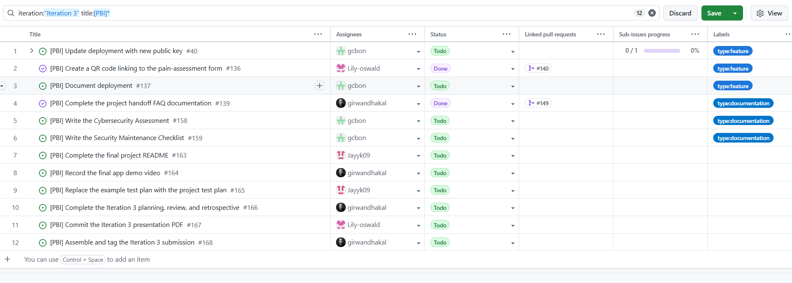

# Iteration 3 Planning

## Iteration Goal

Get the pain assessment ready for handoff to Mia. Fix production email delivery, verify the booking links, and give clients a QR code they can scan to open the form. Finish the guides, security documentation, and test plan so the sponsor and future maintainers can use, deploy, and verify the site.

## Sponsor Planning Notes

- Mia wants a QR code for in-person events that opens the pain-assessment form directly. Confirm the production URL and test the code on iPhone, Android, and a printed copy before sharing it. [Stand-up 21](https://github.com/Naturallee-Goode/Paid-Pain-Assessment/issues/135#issuecomment-6615063022)
- Confirm with Mia and the previous team who controls the live site, how to update it, which inbox should receive submissions, and which Calendly links to use. Hosting access is the dependency for updating the EmailJS key and verifying delivery. Once access is confirmed, use synthetic submissions to test the live form and record any remaining blockers. [Hosting investigation #68](https://github.com/Naturallee-Goode/Paid-Pain-Assessment/issues/68) · [Iteration 2 review](../iteration-2/review.md)

## Selected Work

Prioritize deployment access and email delivery. Draft the guides and test the QR code while access is being resolved. Track changes to scope and assignments in the [GitHub Project](https://github.com/orgs/Naturallee-Goode/projects/1).

| Issue | Assignee | Planned outcome |
| --- | --- | --- |
| [#40](https://github.com/Naturallee-Goode/Paid-Pain-Assessment/issues/40) | Griffen Bon | Update the live EmailJS public key and verify that a test submission reaches the intended inbox. |
| [#136](https://github.com/Naturallee-Goode/Paid-Pain-Assessment/issues/136) | Lily Oswald | Create PNG and SVG QR codes for the public form and verify phone and print scans. |
| [#137](https://github.com/Naturallee-Goode/Paid-Pain-Assessment/issues/137) | Griffen Bon | Document how to deploy the site and update EmailJS and Calendly settings. |
| [#139](https://github.com/Naturallee-Goode/Paid-Pain-Assessment/issues/139) | Girwan Dhakal | Finish the handoff FAQ covering account ownership, costs, data handling, and common problems. |
| [#158](https://github.com/Naturallee-Goode/Paid-Pain-Assessment/issues/158) | Griffen Bon | Document where intake data goes, the main security risks, and open questions about production settings. |
| [#159](https://github.com/Naturallee-Goode/Paid-Pain-Assessment/issues/159) | Griffen Bon | Write the security maintenance checklist with owners, check intervals, and incident steps. |
| [#163](https://github.com/Naturallee-Goode/Paid-Pain-Assessment/issues/163) | Jay Roy | Update the README with deployment status and links to the handoff materials, demo, and remaining backlog. |
| [#164](https://github.com/Naturallee-Goode/Paid-Pain-Assessment/issues/164) | Girwan Dhakal | Record the body map, intake, submission, and booking flow using synthetic data. |
| [#165](https://github.com/Naturallee-Goode/Paid-Pain-Assessment/issues/165) | Jay Roy | Replace the sample test plan with setup steps and checks for desktop, mobile, keyboard use, submission and retry, and booking. |
| [#166](https://github.com/Naturallee-Goode/Paid-Pain-Assessment/issues/166) | Girwan Dhakal | Record the plan and snapshot, then document the results and retrospective at the end of the iteration. |
| [#167](https://github.com/Naturallee-Goode/Paid-Pain-Assessment/issues/167) | Lily Oswald | Export the final presentation to PDF and include it in the repo and submission. |
| [#168](https://github.com/Naturallee-Goode/Paid-Pain-Assessment/issues/168) | Girwan Dhakal | Gather submission evidence, keep unfinished work visible in the backlog, and tag the submitted commit. |

The handoff also includes the developer guide ([#141](https://github.com/Naturallee-Goode/Paid-Pain-Assessment/issues/141), Jay Roy) and the public user guide ([#153](https://github.com/Naturallee-Goode/Paid-Pain-Assessment/issues/153), which Lily volunteered to write in [Stand-up 21](https://github.com/Naturallee-Goode/Paid-Pain-Assessment/issues/135#issuecomment-6615063022)). Both are outside the supplied snapshot.

## Planning Snapshot

