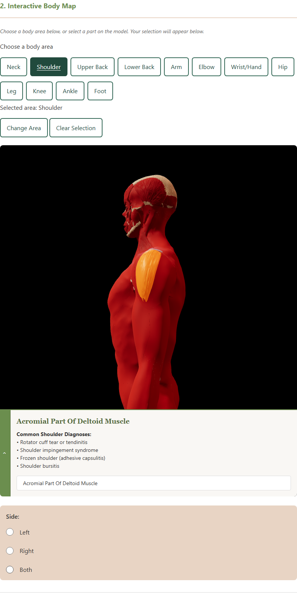
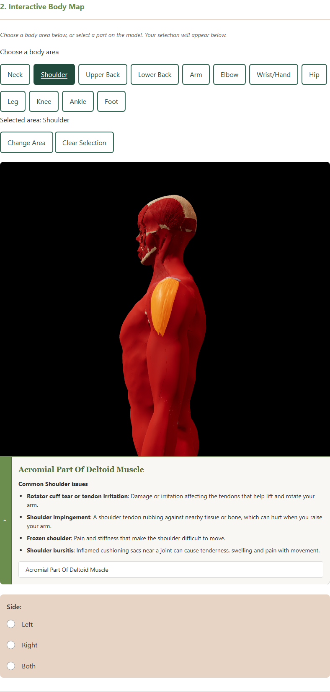

# Issue 81 — verification and stand-up evidence

Prepared October 13, 2026 on `feature/issue-81`, starting from `f26013a`. Implementation, content review materials, and verification evidence are included for pull-request review. Sponsor content approval and team review remain outstanding; this record does not establish completion of issue 81.

## Before and after

Before development, selecting Shoulder showed model-exploration instructions. Selecting Acromial Part Of Deltoid Muscle displayed four condition names under **Common Shoulder Diagnoses**. The list had no descriptions, used legacy model-region keys, and did not record the content's sponsor-review status.

The updated panel uses **Common Shoulder issues** and short explanations. Girwan subsequently requested removal of the visible review label. Review status remains Pending in the content data and review documentation. Area selection and muscle detail reuse the same records keyed by supported body-area ID. The content covers the current configured areas; missing or unavailable records get an explicit message. The expanded panel grows with its descriptions so that the heading, list, and search remain visible on phones. The existing collapse control is retained.

Content has no visible citations or added disclaimer paragraph, as requested. Sources and decisions are recorded in [the content review document](../content/common-issues-review.md). Existing educational wording in the form header and consent remains. The examples are not generated diagnoses or findings about the selected muscle.

## Verification results

| Check | Before | After | Evidence |
| --- | --- | --- | --- |
| Automated unit, DOM, and source checks | 29 passed | 35 passed | [Before](evidence/issue-81/before-unit.txt), [after](evidence/issue-81/after-unit.txt) |
| HTML validation | Three pages passed | Three pages passed | [Before](evidence/issue-81/before-html.txt), [after](evidence/issue-81/after-html.txt) |
| Content browser workflow | Current Shoulder area and muscle behavior reproduced | All supported areas, matching muscle detail, content replacement, Change/Clear, form reset, proposed/approved/unavailable rendering, and a 390px viewport passed; review label removal reverified | [Before](evidence/issue-81/before-browser.txt), [after](evidence/issue-81/after-browser.txt), [label removal](evidence/issue-81/review-label-removal-browser.txt) |
| Existing browser regression suite | Not recorded in this baseline capture | Area highlighting, camera controls, keyboard selection, three layouts, reset, delayed/failed model, and unavailable viewer passed | [After](evidence/issue-81/after-browser.txt) |
| JavaScript syntax | Existing source baseline | All 15 source modules passed | [Syntax log](evidence/issue-81/after-syntax.txt) |
| Content and review coverage | Legacy region lists | All configured IDs represented and review table agrees with data | [Coverage snapshot](evidence/issue-81/content-coverage.json), automated test log |

Browser captures reported no JavaScript page errors. No form was submitted. The screenshot harness pauses continuous rendering and renders the actual model once after each action, using the app's reduced-motion behavior; it does not change production rendering. Fixture states are injected only into the isolated test browser, not saved into the app's data.

## Screenshot evidence

The JSON manifests record capture timestamps, viewport sizes, descriptions, and fixture labels: [before](evidence/issue-81/before-captures.json), [after](evidence/issue-81/after-captures.json).

| Scenario | Before | After |
| --- | --- | --- |
| Shoulder without muscle selection | [Area screenshot](evidence/issue-81/before-shoulder-area.png) | [Area screenshot](evidence/issue-81/after-shoulder-area.png) |
| Selected deltoid on desktop | [Diagnosis heading](evidence/issue-81/before-shoulder-muscle.png) | [Issue descriptions](evidence/issue-81/after-shoulder-muscle.png) |
| Selected deltoid at 390px | [Mobile baseline](evidence/issue-81/before-shoulder-mobile.png) | [Mobile descriptions](evidence/issue-81/after-shoulder-mobile.png) |
| Change to Foot | — | [Replaced area content](evidence/issue-81/after-foot-area.png) |
| Approved rendering, **test fixture only** | — | [Fixture screenshot](evidence/issue-81/after-approved-fixture.png) |
| Unavailable rendering, **test fixture only** | — | [Fixture screenshot](evidence/issue-81/after-unavailable-fixture.png) |





The approved screenshot demonstrates the renderer's approval path. It is explicitly labeled as a fixture and is not evidence of actual approval. Mia's decision is still required before presenting these records as final or marking the issue Done.

## Acceptance-criteria evidence

| Issue 81 criterion | Evidence / remaining work |
| --- | --- |
| A content record for every agreed supported area using its stable ID | `COMMON_ISSUE_CONTENT`, coverage snapshot, and dynamic coverage tests against `SUPPORTED_BODY_AREAS` |
| Proposed examples or an explicit unavailable state | Source-backed proposed records and unavailable-record DOM/browser fixtures |
| Mia's decisions and requested changes recorded; only approved content presented as final | Review fields and table are prepared; all real entries remain Pending. Girwan requested removal of the visible review label in the local preview, so the visible approval distinction is deferred. Actual sponsor decisions remain outstanding. An incomplete or non-sponsor approval displays an unavailable state. |
| “Common [area] issues” headings, including muscle detail | Shared renderer, all-area browser checks, and selected-deltoid screenshots |
| Educational wording with no claim that a selection identifies pain's cause | Existing educational form header and consent are preserved and tested. Copy uses general descriptions. Girwan requested no added disclaimer paragraph in the panel. |

Area/boundary decisions belong to [issue #96](https://github.com/Naturallee-Goode/Paid-Pain-Assessment/issues/96). This implementation uses the current baseline without adding proposed Arm/Leg subdivisions or changing boundaries. Related area-flow work is tracked in [#74](https://github.com/Naturallee-Goode/Paid-Pain-Assessment/issues/74) / [PR #79](https://github.com/Naturallee-Goode/Paid-Pain-Assessment/pull/79); only its content is reused here, not its wider interaction changes.

## Repeat verification

The review email was saved as an unsent Gmail draft to the sponsor contact configured in the app (`goode@naturalleegoode.com`), with subject **Review requested: common issues for each body area**. Its [local text copy](../content/common-issues-review-email.md) and [HTML copy](../content/common-issues-review-email.html) contain all 12 supported regions, 24 descriptions, and their source links. A check compared each item and citation with the app's content data. Creating this draft does not record Mia's review or send a message.

Run `npm run test:body-map`, `npm run lint:html`, and `npm run test:browser` from the repository root. The last command runs the existing browser suite and the new content suite. To regenerate current screenshots in PowerShell:

```powershell
$env:ISSUE81_EVIDENCE_DIR = 'docs/testing/evidence/issue-81'
node tests/common-issues-browser.cjs
```

The before screenshots were captured before source edits using `node tests/common-issues-browser.cjs --before`. That mode should be used only against the original baseline, not the updated app. Both modes serve the app internally with the correct JavaScript MIME types; no separate server is needed for tests.

For human review, refresh the running local preview at `http://127.0.0.1:8082/`, select Shoulder, and search for deltoid. Compare it with Foot, try Clear Selection, and inspect the 390px layout. Do not use real client data or submit the form during review.

## Stand-up draft

Use this as evidence for the work, adapting the previous commitment and meeting details to the actual stand-up:

> I implemented issue 81 on `feature/issue-81` and prepared the implementation and evidence for pull-request review. I reused the draft research from PR 79, prepared content records for every supported body area, changed “Diagnoses” to “issues,” and added short explanations. I kept citations in the review documentation and removed the extra panel disclaimer and review label requested during review. Area and muscle detail share the same content. Sponsor-review status remains Pending in the data and documentation. I prepared an unsent content-review email listing every area with citations. I saved before-and-after desktop and mobile screenshots and approval/unavailable test fixtures. All 35 automated tests, HTML checks, syntax checks, and both browser suites pass. My next step is to review the implementation and obtain Mia's content decisions; her approval and any boundary changes from issue 96 remain dependencies. Codex assisted with implementation, researched copy, testing, and evidence; I still need to review and understand the work before approval and merge.

This is a local draft, not a posted stand-up or a claim of human review. The screenshot links and test logs above can be attached to the actual stand-up record.
