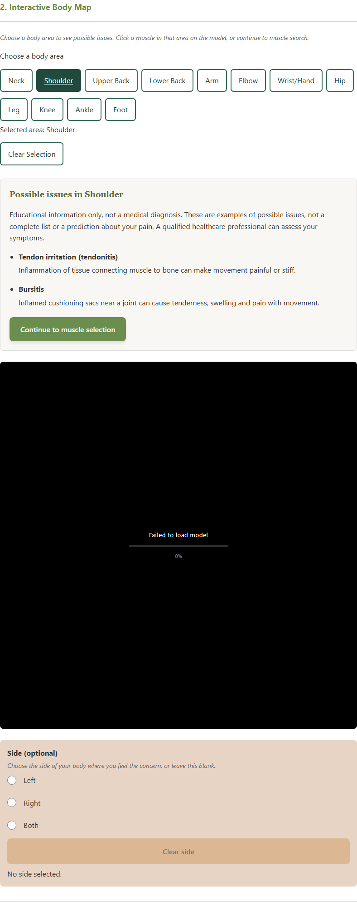
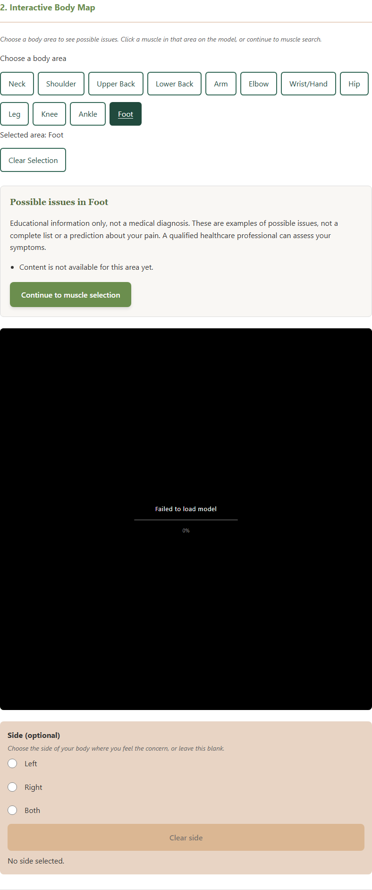

# Issue #82 — area-information edge cases

Verified October 15, 2026 on `fix/82-area-information-edge-cases`, integrating `origin/main` at `f2d632dbbc9a2727331e02ada849b26433aff503` after PR #79 merged. Owner: Girwan Dhakal; Iteration 2. [PR #110](https://github.com/Naturallee-Goode/Paid-Pain-Assessment/pull/110) contains this fix and evidence. The issue remains open pending review and merge.

## Scope and integration

Reuse the integrated area-information feature, verify its edge cases, and add only the demonstrated missing-content gap. The existing `possibleIssues` panel already subscribes to the shared store before viewer startup and sits outside the loading overlay. It supports all configured areas, area replacement, Clear Selection, confirmed form reset, delayed/failed model loading, and optional muscle/side selection.

This branch adds the message **Content is not available for this area yet.** when a supported area has an empty issue list. Continue remains available. The message reuses the wording from #81 / #105; content research and sponsor approval stay under #81. A small import-version increment ensures the updated renderer is requested.

The original branch was created from main at `f26013a` before #79 merged. After main advanced, four files conflicted and the two implementations would have produced duplicate panels. Integration retained main's app entry point, HTML, selection store, viewer, side controls, and reset implementation. The provisional extra panel and copied #81 modules were removed. The new issue #82 diff therefore consists of the fallback, focused verification, and evidence. There is no production diff in the viewer, body-map store, body-area controls, HTML, or form script relative to merged main.

## Acceptance / gap matrix

| Criterion | Reused implementation | Fix / verification |
| --- | --- | --- |
| Identify existing work and remaining gaps after #74 | [#74](https://github.com/Naturallee-Goode/Paid-Pain-Assessment/issues/74) / [merged PR #79](https://github.com/Naturallee-Goode/Paid-Pain-Assessment/pull/79) supply the independent information panel and selection flow. | Checked integration against main at `f2d632d`; only missing-content feedback remained unmet. This was an integration check, not a repeat of the earlier PR review. |
| Every supported area shows its name and issues without muscle, side, or mode choices | `initializePossibleIssues`, `SUPPORTED_BODY_AREAS`, and the existing content data. | Existing unit tests plus all actual area buttons in each isolated browser scenario. Current 12 areas pass without muscle or side choices. |
| Area changes replace information; reset clears stale content | Existing area transitions and Clear Selection/form reset. | Browser and DOM assertions check replacement, empty title/list, hidden panel, and preserved unrelated answers after Clear Selection. |
| Missing content shows the agreed message | Existing lookup returns an empty list for unavailable content, but previously rendered a blank list. | Add the fallback to the existing renderer. A browser-only Foot fixture verifies the message and absence of stale Ankle/Shoulder content. |
| Delayed/failed model loading leaves information usable | Existing panel initializes independently of the viewer. | Five scenarios: delayed completion retaining the latest area, reset before completion remaining empty, GLB failure, failed viewer import, and missing content with model failure. |
| Durable integration evidence | An open PR alone does not complete the issue. | Updated screenshots, result records, browser manifest, and this matrix; keep #82 In Progress until review and merge. |

## Verification results

| Check | Integrated result | Evidence |
| --- | --- | --- |
| `npm run test:body-map` | 45 passed, 0 failed | [Recorded result](evidence/issue-82/unit-results.txt) |
| `npm run lint:html` | All three pages passed | [Recorded result](evidence/issue-82/html-results.txt) |
| `node --check` for every source JS/MJS file | All 19 passed | [Syntax result](evidence/issue-82/syntax-results.txt) |
| `npm run test:browser` | Full loaded-model workflow and all five isolated scenarios passed | [Recorded result](evidence/issue-82/browser-results.txt), [capture/scenario manifest](evidence/issue-82/browser-results.json) |

The integrated browser run retains #79's regressions for repeated selection by click/Enter with Left/Right/Both/no side, multi-area muscle selection, side filtering, material cleanup, camera reset, keyboard controls, direct model selection, and form reset. It also checks 390/768/1280px layouts without horizontal overflow. New coverage exercises every area in each isolated loading scenario, catalog completion/failure, missing content, and reset during a pending model request.

No intake was submitted or email sent. No unexpected page errors occurred. The unavailable-viewer scenario expects exactly its failed dynamic-import error while controls and information remain usable. The browser suite serves the actual app with the checked-in GLB and pauses the existing heavy render loop for assertions. The missing-content fixture intercepts only Foot's data lookup in an isolated browser; no production content record is changed.

## Screenshots

Two screenshots were regenerated against the integrated code and visually inspected. Reset is verified by automated empty-title/list and hidden-panel assertions, keeping the requested two-image limit.

## Reproduce and remaining work

Run `npm run test:body-map`, `npm run lint:html`, and `npm run test:browser`. Set `ISSUE82_EVIDENCE_DIR=docs/testing/evidence/issue-82` before the browser command to regenerate the two images and manifest. This workstation uses `PLAYWRIGHT_BROWSERS_PATH=C:\Users\g_dha\AppData\Local\ms-playwright`; CI installs its matching Chromium runtime.

Sponsor content approval (#81), boundaries (#96), and mode/layout work retain their separate scope. Existing sources and limitations remain in [the integrated feature record](possible-issues.md). The unavailable wording comes from [#81's renderer](https://github.com/Naturallee-Goode/Paid-Pain-Assessment/blob/5ffabdbeaeb319f616b55b181ed2235cc625081a/src/common-issues.mjs); this branch no longer depends on PR #105's source modules.

Codex assisted with integration, conflict resolution, the focused fallback, tests, screenshots, documentation, and PR preparation using the cs-495-workflow and git-commit-messages skills. Automated checks and image inspection were performed by Codex. Human review, sponsor approval, and merging this fix are not represented as completed.
