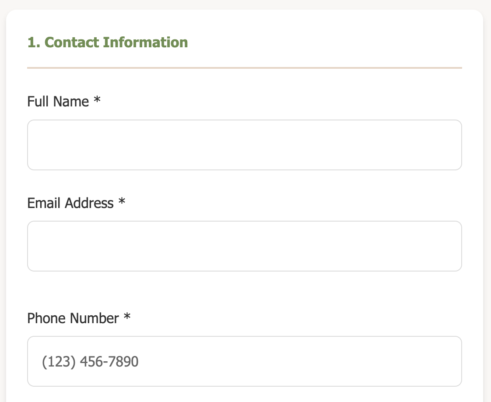
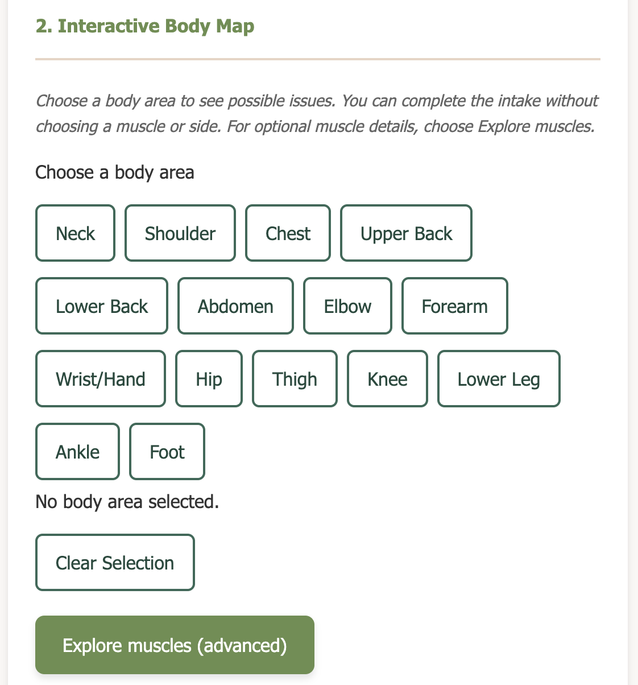
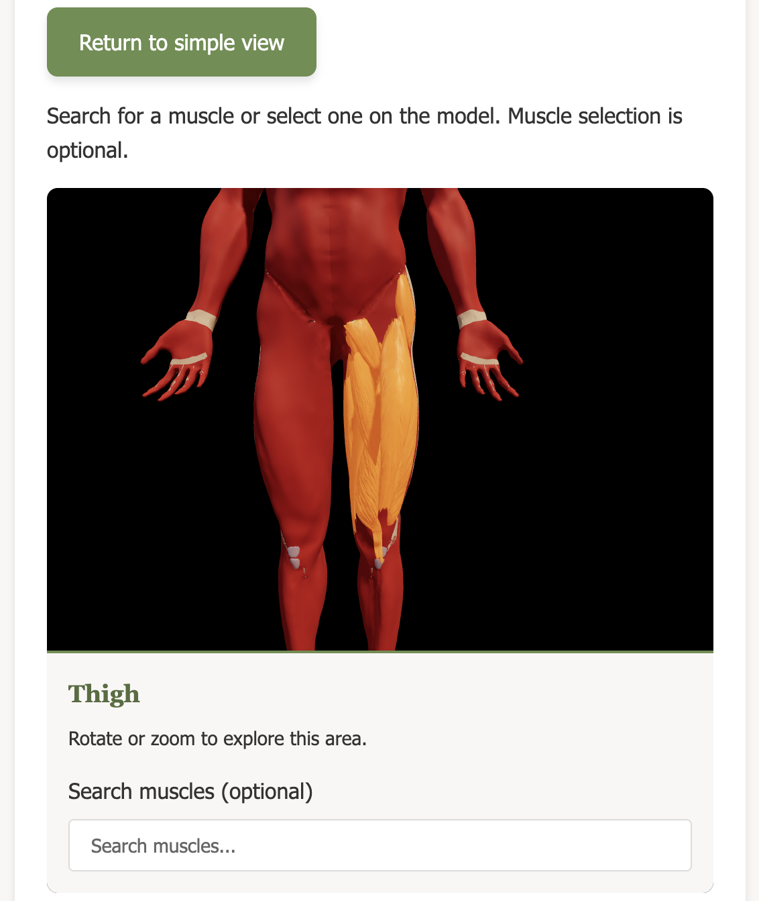
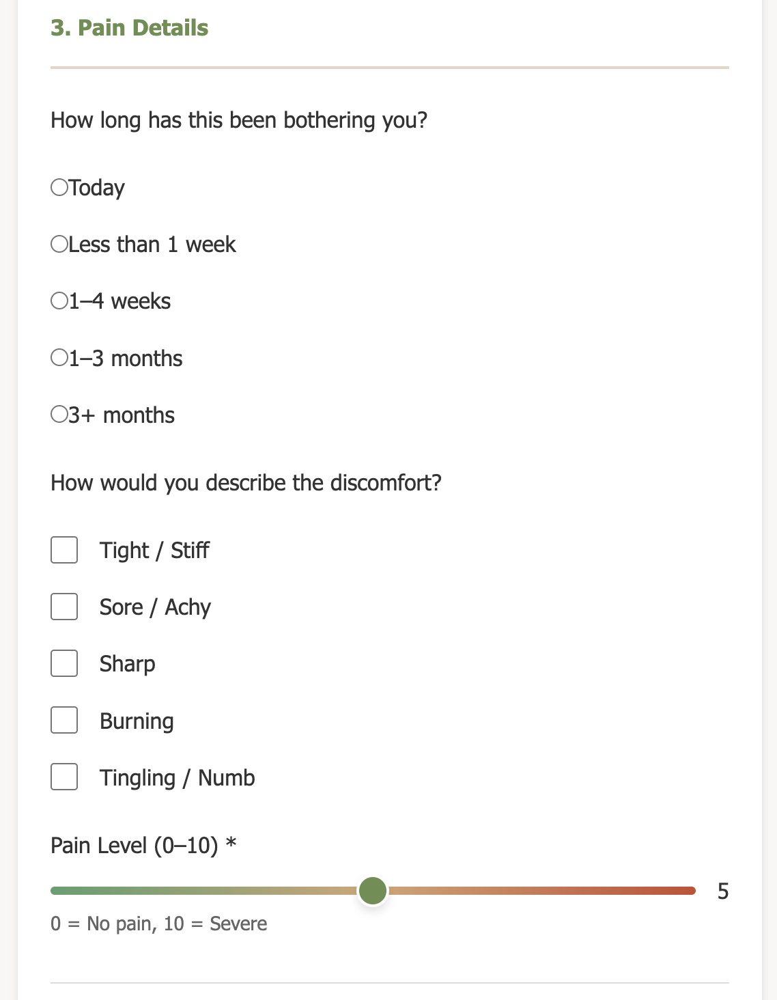
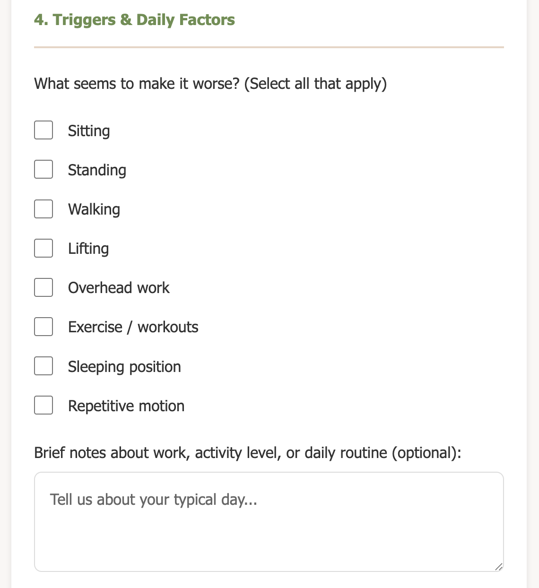
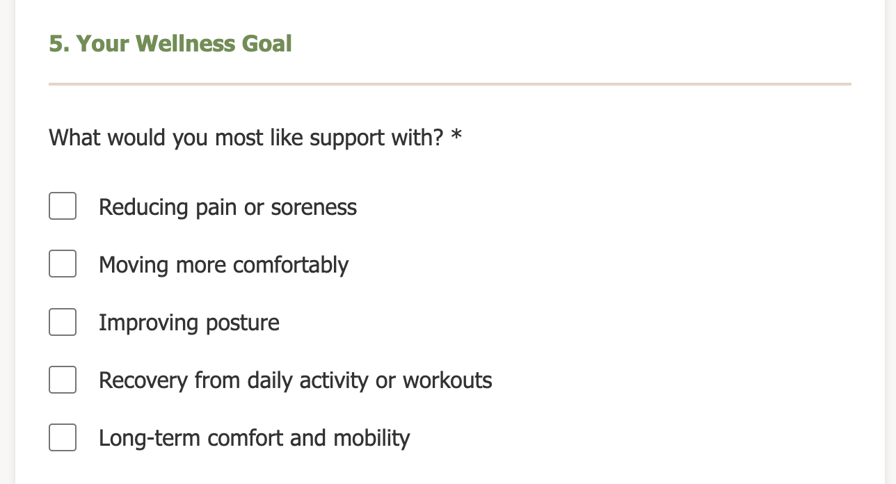
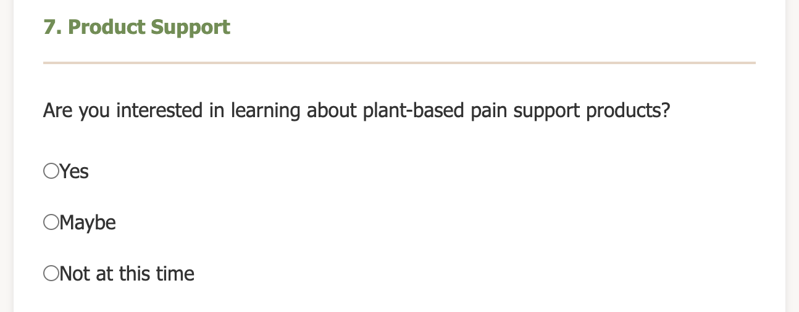
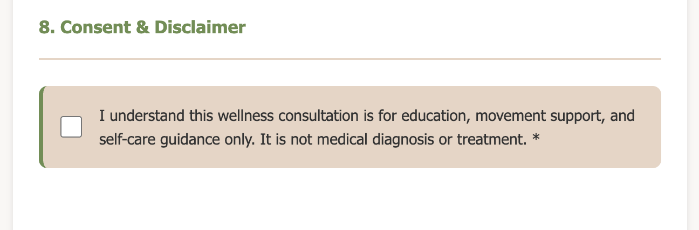
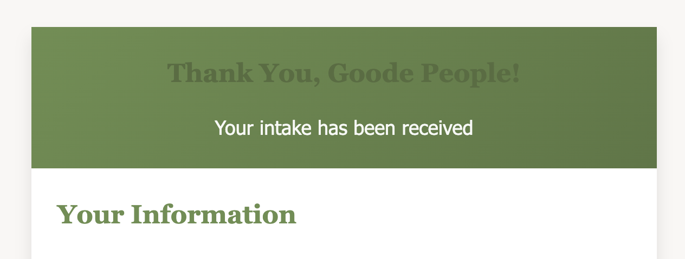

# Paid Pain Assessment User Guide

## Overview

The Paid Pain Assessment is a browser-based wellness intake form. It helps you describe areas of discomfort, review educational information, choose a consultation type, and schedule a session.

No account or sign-in is required.

> This tool provides wellness education, movement support, and self-care guidance. It does not provide medical diagnosis or treatment.

## Before You Begin

For the best experience:

- Use a current version of Chrome, Safari, Firefox, or Edge.
- Connect to the internet.
- Allow camera access only if you choose to use a movement scan.
- Have your contact information available.
- Allow several minutes to complete the intake and schedule a consultation.

## Opening the Assessment

Open the live assessment using its direct link or scan the approved QR code with your phone's standard camera.

The QR code opens a blank intake form on the production site.

## Completing the Intake Form

Fields marked with an asterisk (`*`) are required.

### 1. Contact Information

Enter your full name, email address, and phone number. Make sure the information is correct so the wellness provider can contact you.

### 2. Interactive Body Map

The body map begins in simple view.

1. Choose the body area where you feel discomfort.
2. Review the educational list of possible issues.
3. Optionally choose **Left**, **Right**, or **Both**.
4. Select **Clear Selection** or **Clear side** to remove a choice.

The possible-issues information is educational and is not a diagnosis.

#### Provider-Assisted Muscle Selection

The **Explore muscles (advanced)** feature is optional. If a wellness provider is assisting you, they may use it to select a specific muscle and review additional educational information.

You do not need to select a muscle to complete the intake form.

Select **Return to simple view** to close the advanced view. Returning to simple view keeps the selected body area and side but clears the optional muscle selection. Switching body areas clears the previous muscle and side selections.

To use provider-assisted muscle selection, first choose a body area. Then search for a specific muscle or select one on the model.

### 3. Pain Details

Provide information about:

- How long the discomfort has been present
- How the discomfort feels
- Your pain level from 0 to 10

You may select more than one description, such as **Tight / Stiff**, **Sore / Achy**, or **Sharp**.

Pain Level (0-10) is an interactive slider to select your pain level. Moving the slider to the left indicates lower pain and moving the slider to the right indicates a higher pain level.

### 4. Triggers and Daily Factors

Select any activities that make the discomfort worse. You may also enter optional notes about your work, activity level, or daily routine.

Multiple triggers may be selected.

Select the optional notes field and enter any relevant information about your work, activity level, or daily routine.

### 5. Wellness Goal

Select one or more areas where you would like support:

- Reducing pain or soreness
- Moving more comfortably
- Improving posture
- Recovering from daily activity or workouts
- Supporting long-term comfort and mobility

### 6. Consultation Preference

Choose one consultation type:

- **Quick Pain Check** — 15 minutes
- **Movement & Relief Session** — 30 minutes
- **Full Wellness Assessment** — 60 minutes

Your selection determines which scheduling calendar appears after submission.

### 7. Product Support

Indicate whether you are interested in learning about plant-based pain-support products.

### 8. Consent and Disclaimer

Read and accept the required wellness disclaimer before submitting the form.

## Optional Movement Scans

The upper- and lower-body movement scans are optional. They use your device's camera to estimate joint angles and provide movement feedback.

Camera processing occurs locally in the browser. Video is not uploaded or saved by the application. Use the scan only when you have enough clear space to move safely.

### Upper Body Scan

1. Select **Upper Body Scan**.
2. Select **Start Camera**.
3. Allow camera access when prompted.
4. Stand where your upper body and arms are visible.
5. Raise your arms overhead and lower them to complete a repetition.
6. Review the joint angles, score, repetition count, and feedback.
7. Select **Back to Intake Form** when finished.

### Lower Body Scan

1. Select **Lower Body Scan**.
2. Select **Start Camera**.
3. Allow camera access when prompted.
4. Stand where your full body is visible.
5. Perform a squat and return to standing.
6. Review the joint angles, score, repetition count, and feedback.
7. Select **Back to Intake Form** when finished.

Movement scores and feedback are educational and are not medical assessments.

## Submitting the Form

1. Review your responses.
2. Select **Get My Wellness Summary & Book My Session**.
3. Correct any fields highlighted with an error.
4. Wait for the successful-submission message.

After submission, the confirmation screen displays:

- A summary of your information
- The scheduling calendar for your selected session
- The next steps for your consultation

The submitted intake is sent to the wellness provider by email.

## Scheduling a Consultation

Use the calendar on the confirmation screen to select an available date and time. After booking, you should receive a confirmation containing the session details.

## Clearing or Restarting the Form

Select **Clear Form** to remove your responses. Confirm the prompt before the form resets. Clearing the form also resets the body map to its initial simple view.

After a successful submission, select **Return to Form** to start again.

## Keyboard Access

- Press `Tab` to move between controls.
- Press `Enter` or `Space` to activate buttons.
- Use the keyboard to select body areas, side options, and form choices.

## Troubleshooting

### The Form Will Not Submit

- Complete every field marked with an asterisk.
- Enter a valid name, email address, and phone number.
- Select at least one wellness goal.
- Choose a consultation preference.
- Accept the consent and disclaimer.
- Check the page for highlighted error messages.

### A Submission Error Appears

Confirm that you are connected to the internet and try again. If the error continues, contact the wellness provider.

### The Body Map Does Not Load

- Refresh the page.
- Confirm that you are connected to the internet.
- Try a current version of another supported browser.

You can still complete the other intake sections if optional body-map details are unavailable.

### The Camera Will Not Start

- Allow camera access in the browser.
- Confirm that another application is not using the camera.
- Use the secure live site with an `https://` address.
- Refresh the page and try again.

### The Scan Does Not Detect Movement

- Make sure your body is fully visible.
- Improve the lighting.
- Move farther from the camera.
- Remove visual obstructions.
- Perform the movement slowly.

### The Scheduling Calendar Does Not Appear

Confirm that the form was submitted successfully and that you selected a consultation preference. Refresh the page or try another supported browser if necessary.

## Privacy

- No user account is required.
- The QR code contains only the public live-form URL.
- Camera frames are processed locally in the browser and are not saved by the application.
- Intake responses are sent to the wellness provider by email.
- Do not submit information you do not want included with your intake.

## Support

For questions or assistance, contact **Naturallee Goode** at **info@naturalleegoode.com**.
